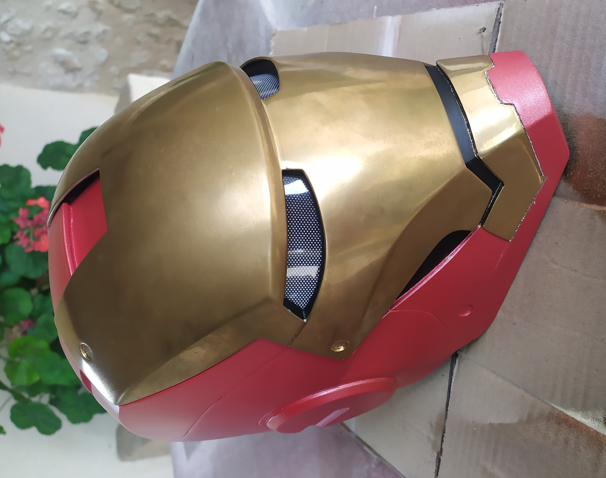
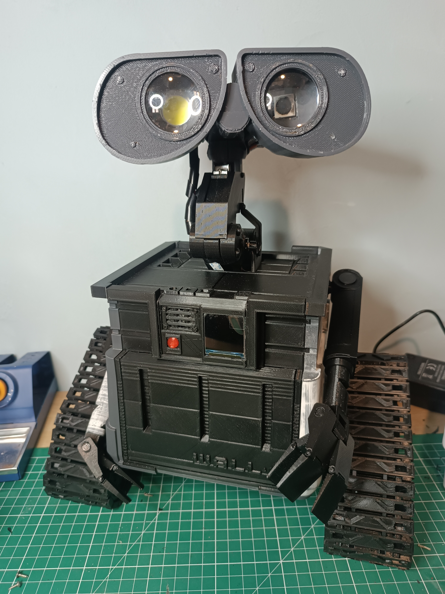
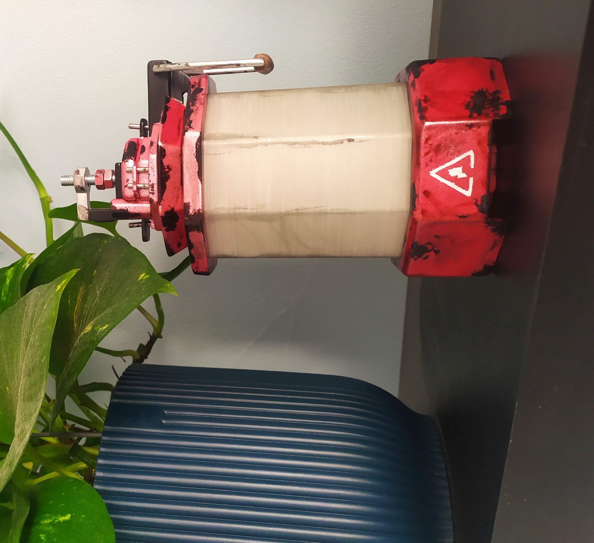

## Hi there, I'm Marc 👋

- 🎉 I'm graduated with an engineering degree in Robotic and Interactive Systems
- 🤖 I enjoy working on personal projects that are often related to the fields of electronics, programming and 3D printing
- 🔭 I'm currently working on a pointcloud viewer

📸 I recommend you go to my website to see a little more in pictures, the projects I have worked on.

  
  
  

